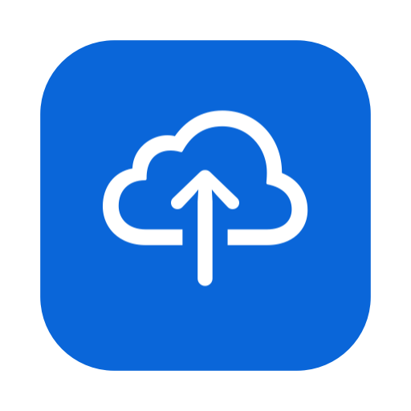
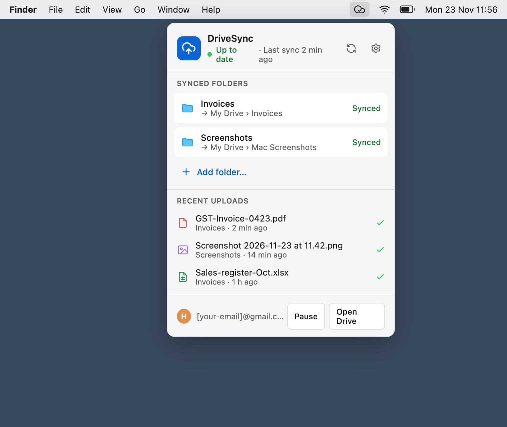

<p align="center"></p>
<h1 align="center">DriveSync</h1>
<p align="center">Two-way sync between folders on your Mac and Google Drive, quietly, from the menu bar.</p>

<p align="center">
  <a href="https://github.com/himxnshudxhiyx/DriveSync/releases/latest/download/DriveSync.dmg"><b>⬇&nbsp; Download DriveSync for macOS</b></a><br>
  <sub>macOS 14 Sonoma or later · Apple Silicon &amp; Intel · <a href="https://drivesync-chi.vercel.app">Website</a> · <a href="https://drivesync-chi.vercel.app/privacy">Privacy</a> · <a href="https://drivesync-chi.vercel.app/terms">Terms</a></sub>
</p>

<p align="center"></p>

## Install

1. [Download **DriveSync.dmg**](https://github.com/himxnshudxhiyx/DriveSync/releases/latest/download/DriveSync.dmg),
   open it, and drag **DriveSync** into **Applications**.
2. Open DriveSync from Applications. It isn't notarized by Apple yet, so the first time macOS says it can't
   verify the app. Click **Done**, then go to **System Settings → Privacy & Security**, scroll down, and click
   **Open Anyway** next to "DriveSync was blocked".
   <sub>Prefer Terminal? `xattr -dr com.apple.quarantine /Applications/DriveSync.app` does the same.</sub>
3. Click **Sign in with Google**. Google shows "Google hasn't verified this app": click
   **Advanced → Go to DriveSync**, and **tick the Google Drive checkbox** on the permissions screen.
4. Choose a Mac folder, type the name of the Drive folder to pair it with (an existing one, or a new one), and
   click **Start syncing**.

DriveSync lives in the menu bar (no Dock icon) and starts automatically when you log in.

## What it does

- Anything you add or change in a linked Mac folder is on Drive about a second later. Drive changes reach your
  Mac within about 10 seconds. Subfolders come along too.
- If a file changes on both sides, your Mac's version wins and Drive keeps the older one in its version history.
- Deleted files go to the Trash, never straight to permanent deletion. Choose per folder whether deletions sync.
- No servers and no analytics: files move directly between your Mac and Google.

---

## Build it yourself

### Google Cloud setup (one time, ~5 min)

DriveSync talks to your Drive through your own Google OAuth client:

1. Go to <https://console.cloud.google.com/>, create a project (any name), and **enable the Google Drive API**
   (APIs & Services → Library → "Google Drive API" → Enable).
2. **OAuth consent screen** (Google Auth Platform → Branding / Audience): user type **External**, any app name,
   your Gmail as support email. Under **Data access**, add the scope `https://www.googleapis.com/auth/drive`.
3. Under **Audience**, click **Publish app** (set it to *In production*). If the app stays in *Testing*, Google
   expires your sign-in every 7 days. For your own use, no verification is needed. On first sign-in you'll see
   "Google hasn't verified this app". Click **Advanced → Go to … (unsafe)**.
4. **Clients → Create client → Desktop app**. Copy the client ID and secret into `google.env` in this folder:

   ```sh
   GOOGLE_CLIENT_ID=1234-abc.apps.googleusercontent.com
   GOOGLE_CLIENT_SECRET=GOCSPX-...
   ```

### Build & install

```sh
./build.sh install   # builds, copies to /Applications, launches
./build.sh dmg       # builds build/DriveSync.dmg for a release
```

The first launch opens onboarding: **Sign in with Google → pick a folder → Start syncing.**
DriveSync also adds itself as a login item, so it runs in the background like a service. You can turn this off in
Settings → General.

### How it works

- `drive` scope: needed to see folders and files you create on drive.google.com. Only linked folders are touched.
- A link pairs a Mac folder with `My Drive › <name>`: it uses an existing folder with that name, or creates one.
- Mac changes are uploaded about 2 s after they happen (FSEvents). Drive is checked on launch, every 60 s, and on
  "Sync now".
- If a file changed on both sides, the Mac version wins. Drive keeps the overwritten one in its version history.
- Deletions follow the per-folder setting: keep the other copy (default), or move it to the other side's Trash.
- Google Docs/Sheets/Slides aren't downloaded, because they have no file to download.
- Pauses when you're offline or in Low Power Mode, and resumes on its own.
- State: `~/Library/Application Support/DriveSync/state.json`. Google refresh token: the login Keychain.

### Code

`Sources/Google.swift` handles OAuth and the Drive API, `Sources/Sync.swift` is the watcher, queue and uploader,
`Sources/Views.swift` holds the UI, and `Sources/App.swift` has the menu bar icon and windows.
`tools/make-icon.swift` regenerates `Resources/AppIcon.icns`.
